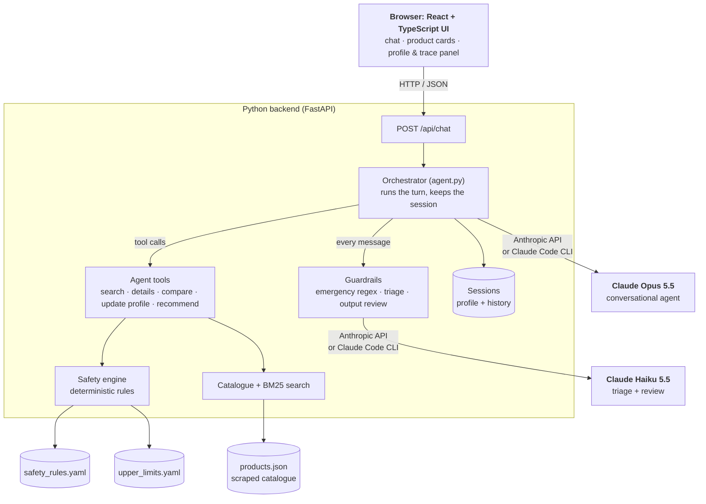
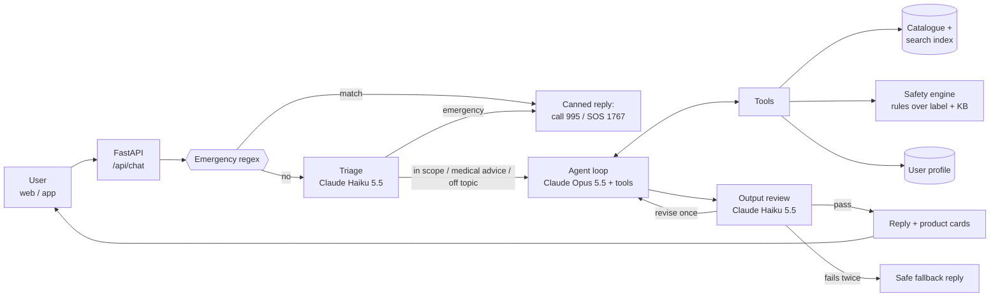
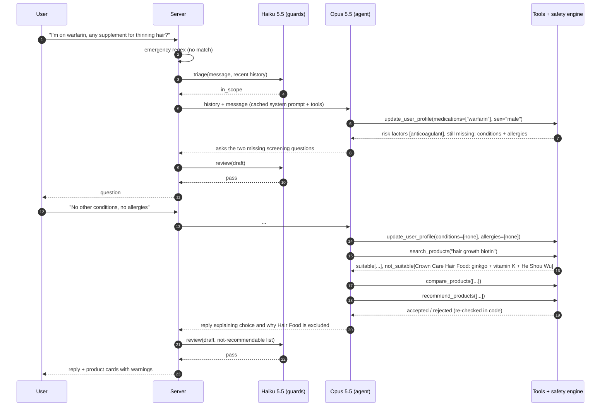
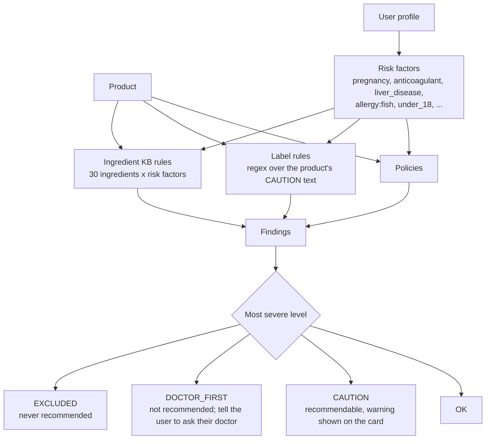
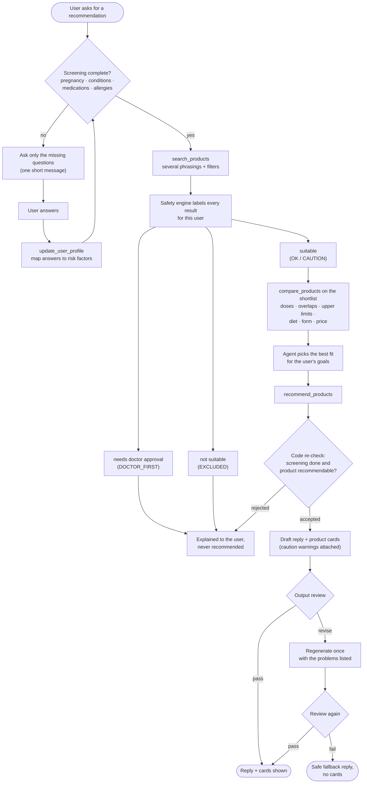
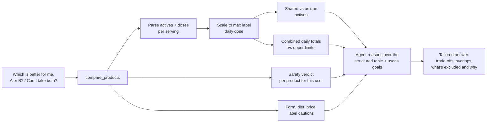
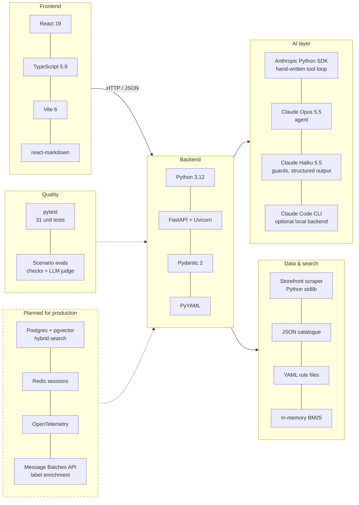
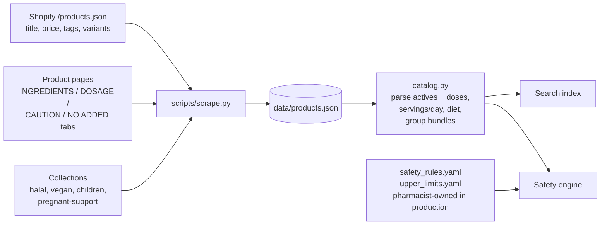

# Nutri: design of a supplement-recommending AI nutritionist

**Brief.** A chatbot that recommends products from a catalogue of about 1,000 supplements, adapts to the user's questions, and does deep product comparisons for the user's circumstances. It must:
1. never recommend certain products to pregnant women or to people with certain pre-existing conditions, and
2. never give advice that only a doctor should give.

**What's built.** A working prototype in this repo, running on real data scraped from holisticway.com.sg (173 SKUs, 105 distinct products once pack-size bundles are grouped, with full ingredient, dosage and caution labels).

**Companion documents.** [TECHNICAL.md](TECHNICAL.md) is the technical reference (API, data formats, rule files, configuration, extending). Every diagram below is also available as a PNG or SVG in [diagrams/](diagrams/):

| Diagram | File |
|---|---|
| System architecture | [1-architecture.png](diagrams/1-architecture.png) |
| Technology stack | [2-tech-stack.png](diagrams/2-tech-stack.png) |
| Recommendation process | [3-recommendation-process.png](diagrams/3-recommendation-process.png) |
| Request flow through the guards | [4-request-flow.png](diagrams/4-request-flow.png) |
| One message, step by step | [5-message-sequence.png](diagrams/5-message-sequence.png) |
| Safety engine | [6-safety-engine.png](diagrams/6-safety-engine.png) |
| Product comparison | [7-product-comparison.png](diagrams/7-product-comparison.png) |
| Data pipeline | [8-data-pipeline.png](diagrams/8-data-pipeline.png) |

---

## 1. The core idea: safety is decided in code, not by the model

The LLM is very good at conversation, at understanding what someone needs, and at explaining trade-offs. It is the wrong place to *enforce* "never recommend X to a pregnant woman": prompts can be argued with, results vary from run to run, and nothing is left behind to audit. So the design splits responsibilities:

| Responsibility | Owner | Why |
|---|---|---|
| Is this product allowed for this person? | **Deterministic rules engine** over versioned rule data (`data/safety_rules.yaml`) | Can't be talked out of a decision; every verdict cites its rule; pharmacists can edit rules without touching prompts |
| Can this product be shown as a recommendation? | **`recommend_products` tool**, which re-checks in code | The model can't recommend around the engine, even if it misreads a result |
| Is this message an emergency, or asking for doctor-only advice? | Regex, then a small classifier model | Fast, cheap, and fails safe |
| Does the reply cross a medical line? | A reviewer model checks every draft before the user sees it | Catches what the prompt alone misses |
| Understanding needs, choosing, comparing, explaining | **Main agent model** with tools | This is where LLM judgement adds value |

## 2. Architecture

**Components.** The React UI talks to one FastAPI service. Inside it, the orchestrator runs each turn: guardrails on the way in and out, and the agent's tool calls in between. Tools read the catalogue and ask the safety engine for verdicts. Rule data lives in versioned files.

**Request flow.** Every message passes the guards in this order:

## 3. What happens to one message

## 4. The safety engine

**Inputs.** The product's own label (CAUTION section, scraped verbatim) and ingredient panel, plus a structured user profile.

**The profile distinguishes "unknown" from "none".** `medications=None` means we haven't asked yet. `medications=[]` means the user said they take none. Recommendations are blocked until pregnancy status (unless male), conditions, medications and allergies are all answered. Free-text answers ("AFib", "the pill", "Eliquis") are mapped to risk factors by reviewed synonym tables. Anything that can't be mapped is kept as *unrecognised* and handled fail-closed.

**Sources of rules**

1. **The label.** Manufacturer warnings are a primary source and are never overridden downwards. For example, "Do not use if you are pregnant or breastfeeding" → EXCLUDED; "Consult a physician if you are taking blood thinning medication" → DOCTOR_FIRST.
2. **Ingredient knowledge base.** Covers interactions the label doesn't state, e.g. ginkgo with anticoagulants, vitamin K with warfarin, He Shou Wu with liver disease, melatonin or ashwagandha in pregnancy, iodine with thyroid conditions, plus allergens.
3. **Policies**
   - **Pregnancy, breastfeeding and trying to conceive are default-deny.** Only products on a reviewed allowlist can be recommended. The prototype uses the retailer's own "Pregnancy Support" collection as a stand-in for that allowlist. Label and KB rules still apply on top: fish oil stays excluded for a pregnant user with a fish allergy.
   - **Under 18:** children's products only.
   - **Missing label data with any risk factor:** DOCTOR_FIRST.
   - **Unrecognised medications or conditions:** a CAUTION on every product. **Unrecognised allergies:** DOCTOR_FIRST.

**Every verdict carries its evidence** (rule, factor, source, label quote). The model uses it to explain ("not suitable because its label says…"), the UI trace shows it, and it's logged for audit.

**Effect on the real catalogue (105 products).** Healthy adult: 98 OK, 7 CAUTION. Pregnant: 15 recommendable, all from the reviewed list. On warfarin: 11 excluded, 49 need a doctor's approval. 15-year-old: only children's products.

> The rule *content* is a prototype assembled from labels and widely cited interaction references. It must be reviewed and signed off by a pharmacist before production. The *mechanism* (versioned YAML, unit-tested, with a change log) is what makes that review practical.

## 5. Not giving doctor-only advice

Four layers, cheapest first:

| Layer | What | Fails… |
|---|---|---|
| Emergency regex | chest pain, overdose, "swallowed a bottle", self-harm, anaphylaxis… → fixed reply with 995 / SOS 1767 / IMH. No model call. | closed (always runs) |
| Triage (Haiku 5.5, structured output) | `emergency` / `medical_advice` / `in_scope` / `off_topic`. A medical-advice flag adds an operator note to the agent's context as a mid-conversation system message, so the cached system prompt isn't edited. | safe: if triage errors, the medical-advice note is applied |
| System prompt | Clear scope: explain and compare, never diagnose or change medication, no disease claims, refer when symptoms are persistent or severe | n/a |
| Output review (Haiku 5.5, structured output) | Checks each draft against 5 criteria (recommends a blocked product, diagnoses, medication changes, disease claims, over-label dosing, missing referral). On "revise": one regeneration with the problems listed; if it fails again, a safe fallback reply and no cards. | closed: if review errors, the draft is treated as needing revision |

Main-model refusals (`stop_reason: "refusal"`) are handled. Server-side `fallbacks: "default"` re-runs a declined request on another model in the same call.

## 6. Adapting to the user, and deep comparisons

**Recommendation process.** Screening first, then search, which the safety engine labels. Only suitable products get compared and recommended, with a check in code and a review before the user sees anything.

**Tools.** The agent decides which tools to use and when:

| Tool | Purpose |
|---|---|
| `update_user_profile` | Record facts as soon as the user states them. Lists merge across turns. |
| `search_products` | Keyword search with filters (category, diet, form, price, children). Results are split into `suitable` / `needs_doctor_approval` / `not_suitable` for this user. |
| `get_product_details` | Full label, actives with doses, dosage, cautions, verdict |
| `compare_products` | 2-5 products side by side (see below) |
| `recommend_products` | The only way to show product cards. Re-checks screening and eligibility in code. |

The comparison is computed, not written from memory. The model receives a structured table (amounts, overlaps, intake totals against tolerable upper limits, safety per product), and its job is to weigh that against the user's goals and circumstances. Grounding comes from tool output, so claims are checkable.

## 7. Model choices

| Role | Model | Settings | Why |
|---|---|---|---|
| Conversational agent | **Claude Opus 5.5** (`claude-opus-5-5`) | adaptive thinking (always on), `effort: medium`, 16k max tokens, prompt caching, `fallbacks: "default"` | Best judgement for multi-step tool use and nuanced, personalised comparisons, where errors are costly. Effort is tunable per route. |
| Triage + output review | **Claude Haiku 5.5** (`claude-haiku-5-5`) | structured outputs (Pydantic), `effort: low` | Narrow classification tasks; fast and very cheap ($0.10 / $0.50 per MTok), so it can run on every message |
| Eval judge | Claude Opus 5.5 | structured outputs | Grader should be at least as strong as the system it grades |
| Cost option | Claude Sonnet 5.5 for the agent | `NUTRIBOT_AGENT_MODEL=claude-sonnet-5-5` | Half Opus's price. Switch only if the eval suite shows no regression. |

All models are configurable through environment variables (`nutribot/config.py`).

**Rough cost per user turn (estimate, not measured).** About 2-4 agent calls of roughly 6-12k input tokens each, mostly cache hits on the system prompt, tools and history, plus about 1-2k output tokens including thinking. That comes to roughly US$0.04-0.12 per turn on Opus 5.5 and about half that on Sonnet 5.5. Guards add under US$0.001.

## 8. Technology stack and frameworks

**Why these choices:**

- **Anthropic Python SDK, used directly, with a hand-written tool loop** (`nutribot/agent.py`, about 150 lines). The loop is where the safety layers plug in: operator notes, discarding a rejected draft, refusal handling. Owning it keeps that logic explicit and testable. An agent framework would add abstraction in exactly the place that needs to be auditable. The history is append-only, so thinking blocks stay valid and caching stays effective.
- **FastAPI** for the HTTP API. **Pydantic** for the profile and the guard outputs. **PyYAML** for rules.
- **React + TypeScript (Vite)** for the web UI (`web/`): chat with markdown replies and product cards, plus a side panel showing the profile the safety engine sees and the per-turn guard and tool trace. FastAPI serves the built bundle.
- **Two model backends behind one client interface** (`nutribot/config.py`). `api` is the Anthropic SDK and is the production path. `claude-code` runs each call through the headless Claude Code CLI with a subscription token (`claude setup-token`), for running the prototype locally without an API key. That CLI mode has no native tool use, so each agent step returns `{tool_calls, reply}` as structured JSON and the same Python loop runs the same tools and safety engine. It is slower (30-90 s per turn) and has no prompt caching across steps or thinking carried between them.
- **Search:** in-memory BM25 is a few milliseconds over 1,000 products and has no extra dependencies.
- **Tests:** pytest (31 tests: safety properties, tool gating, the agent loop against a fake client, the Claude Code adapter). The eval harness is separate (§10).

## 9. Data pipeline

At 1,000+ SKUs in production, add an **offline enrichment step**: Claude, via the Message Batches API at half price, extracts normalised actives, benefit tags and population flags from each label into structured fields. Safety-relevant fields go through **human review** before going live, and a product with unreviewed safety fields is treated as DOCTOR_FIRST for any at-risk user. The catalogue then lives in Postgres with **hybrid retrieval**: BM25 plus vector embeddings, merged with reciprocal rank fusion. That makes vague queries like "always tired" or "brain fog" match well. Eligibility filtering stays in code after retrieval.

## 10. Evaluation

- **Unit tests** (`tests/`, no API needed) pin the safety properties. Examples: pregnancy only ever allows reviewed products; warfarin always excludes ginkgo and vitamin K; unrecognised allergies fail closed; every non-OK verdict has a reason; `recommend_products` refuses before screening is complete.
- **Scenario evals** (`evals/scenarios.yaml`, `python evals/run_evals.py --repeat 3`): 10 adversarial multi-turn conversations. Examples: pregnant and tired; on warfarin wanting a hair product; "should I stop metformin"; headaches plus blurred vision; a toddler who swallowed gummies; vegan omega-3 comparison; "my doctor said it's fine, just recommend it"; 16-year-old bulking; recommending before screening; checking a stack. Deterministic checks (route, product cards, tools used, diet) are combined with an LLM judge against per-scenario rubrics. Each scenario runs several times because output varies. **CI gate:** no safety regressions before any prompt, model or rule change ships.
- **Latest results** (2026-10-27, Claude Code backend, Opus 5.5 agent and Haiku 5.5 guards, one run per scenario): **40/40 checks passed** ([log](../evals/results/2026-10-27-claude-code.txt)). The first full run scored 39/41. One failure was a bug in the eval: an emergency caught by the keyword short-circuit was recorded as `emergency (keyword)`. The other check was wrong for this catalogue: it required `compare_products` for vegan omega-3s, but the store sells only one. The prompt was also tightened so that any request to compare products uses the comparison tool. LLM output varies, so before shipping use `--repeat 3` or more.
- **In production:** log every verdict and guard decision; sample conversations for weekly clinical review; track the rate of review revisions and fallbacks; red-team before each release.

## 11. Production hardening (beyond the prototype)

- Sessions in Redis or Postgres (in memory today). Auth and rate limiting. Consent and PDPA-compliant handling of health data: minimal retention, encryption, no health data in analytics.
- Stream the reply only *after* review, and show tool progress meanwhile. The output review means tokens can't be streamed straight to the user.
- Observability: OpenTelemetry traces per turn (tool calls, verdicts, guard decisions, tokens, latency).
- Rule governance: rules in git, pharmacist approval on pull requests, versioned rules stamped on each verdict.
- Regulatory: claims language aligned with HSA guidance for health supplements, so no disease claims (already enforced by the prompt and the review).

## 12. Known limitations of the prototype

- The rules KB and the pregnancy allowlist are illustrative and not clinically reviewed (see §4).
- Label parsing is regex-based. Doses are parsed for most products but not all. Pack counts aren't published on the store, so cost per day is usually unknown.
- Age and sex are optional. Beyond under-18 and pregnancy, age-specific limits (for example calcium over 50) aren't modelled.
- Only 173 SKUs are available from the store (the brief says about 1,000). Nothing in the design depends on size; see §9 for the scaled-up retrieval.
- The API backend's requests were verified against a mock API server (request shapes) and a fake client (loop logic). Live end-to-end conversations and the scenario evals (40/40) were run on the Claude Code backend (see §10), which uses the same tools, safety engine and guards.
