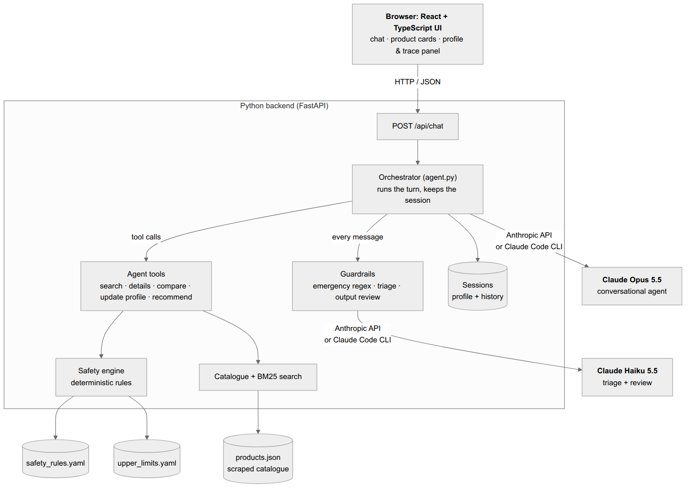
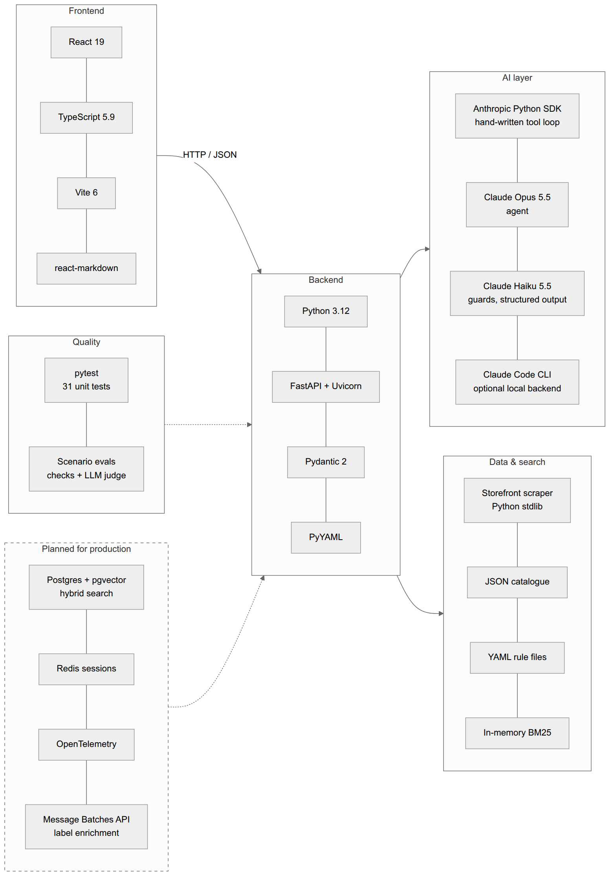
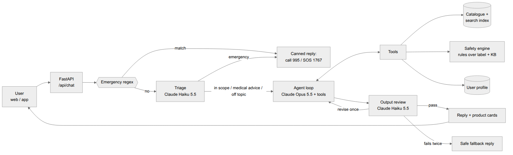
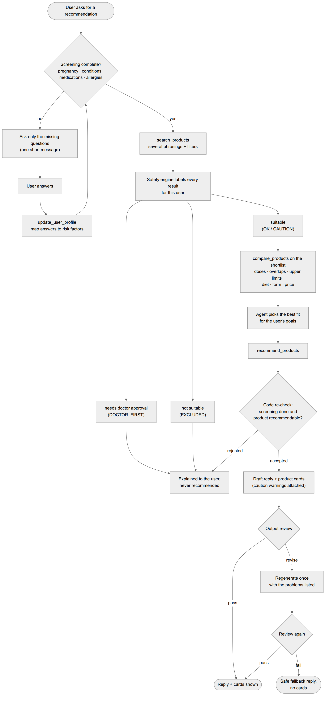
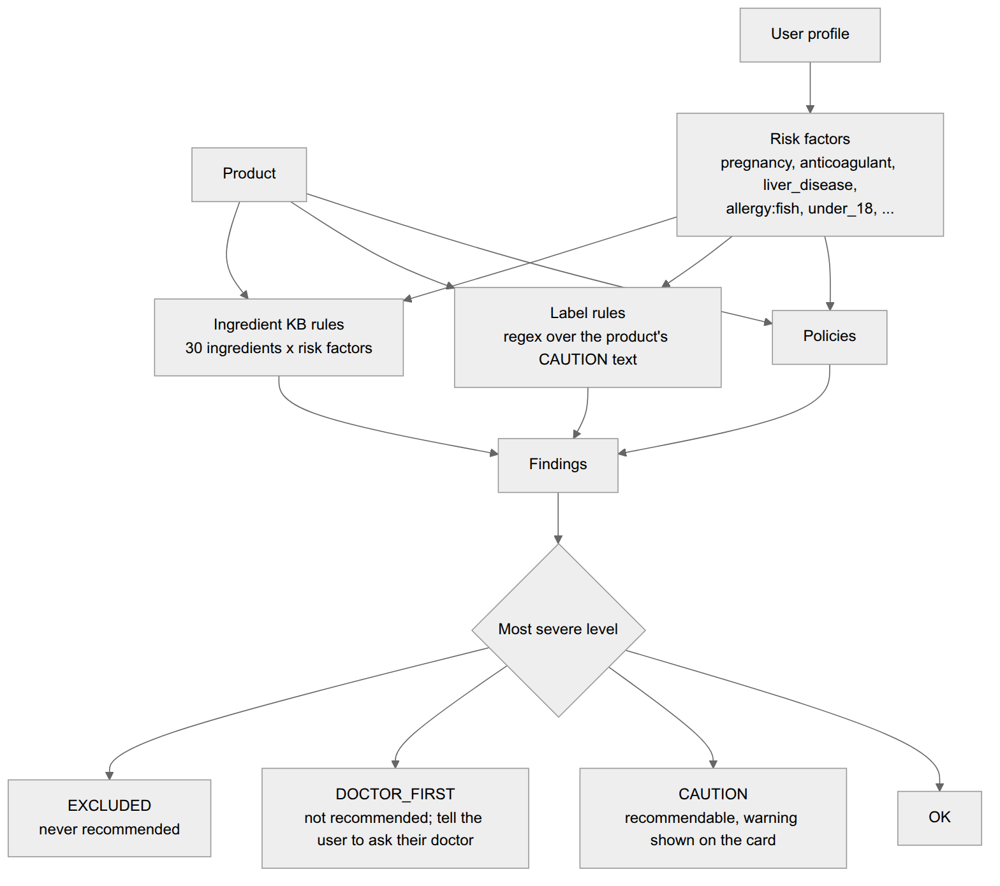
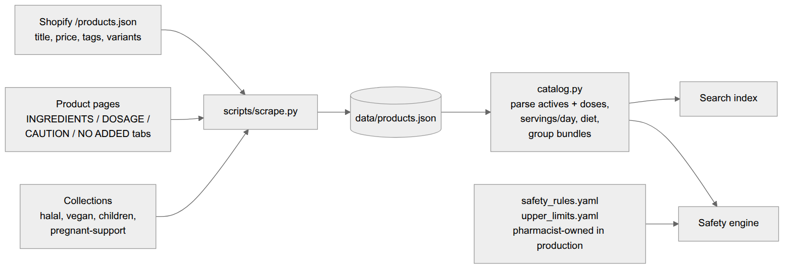

# Nutri: technical documentation

This document is the reference for the code: components, request lifecycle, API, data formats, safety rules, configuration, testing and how to extend the system. For the design rationale (why it is built this way, model choices, production plan) see [DESIGN.md](DESIGN.md). Rendered diagrams are in [diagrams/](diagrams/) as PNG and SVG files, with Mermaid sources (`.mmd`).

## Contents

1. [System overview](#1-system-overview)
2. [Technology stack](#2-technology-stack)
3. [Components](#3-components)
4. [Request lifecycle](#4-request-lifecycle)
5. [Recommendation process](#5-recommendation-process)
6. [HTTP API](#6-http-api)
7. [Agent tools](#7-agent-tools)
8. [Data model](#8-data-model)
9. [Safety engine and rule files](#9-safety-engine-and-rule-files)
10. [Guardrails](#10-guardrails)
11. [Model backends](#11-model-backends)
12. [Configuration](#12-configuration)
13. [Frontend](#13-frontend)
14. [Data pipeline](#14-data-pipeline)
15. [Testing and evaluation](#15-testing-and-evaluation)
16. [Extending the system](#16-extending-the-system)
17. [Operational notes and limitations](#17-operational-notes-and-limitations)

---

## 1. System overview



Nutri is a single Python service (FastAPI) plus a React single-page app.

- **Claude Opus 5.5** runs the conversation and calls tools.
- **Claude Haiku 5.5** classifies each incoming message (triage) and checks each outgoing reply (review).
- Which products a user may be offered is decided **in code** by a deterministic safety engine over versioned YAML rules, never by the model. The model sees the verdicts and explains them, but can't change them. The only way to show a product card, `recommend_products`, re-checks eligibility itself.

## 2. Technology stack



| Layer | Technology | Version | Purpose |
|---|---|---|---|
| Frontend | React | 19.2 | UI components |
| | TypeScript | 5.9 | Type-safe UI code (strict mode) |
| | Vite | 6.4 | Dev server with `/api` proxy, production build |
| | react-markdown + remark-gfm | 10.1 / 4.0 | Rendering formatted replies and comparison tables |
| Backend | Python | 3.12 | Runtime |
| | FastAPI + Uvicorn | 0.156 / 0.54 | HTTP API and static file serving |
| | Pydantic | 2.14 | User profile model and structured guard outputs |
| | PyYAML | 6.0 | Safety rules and upper-limit tables |
| AI | Anthropic Python SDK | 1.17 | Messages API, structured outputs (`messages.parse`) |
| | Claude Opus 5.5 | `claude-opus-5-5` | Conversational agent, adaptive thinking, effort `medium` |
| | Claude Haiku 5.5 | `claude-haiku-5-5` | Triage and output review, effort `low` |
| | Claude Code CLI | 2.1+ | Optional local backend using a `claude setup-token` subscription token |
| Data | Python stdlib (`urllib`, `html`, `re`) | - | Storefront scraper |
| | In-memory BM25 | - | Product search, written in-house (no extra dependency) |
| Quality | pytest | 9.1 | Unit tests (no network needed) |
| | Eval runner | - | Scenario checks plus an LLM judge |

Versions are pinned in `requirements.txt` and `web/package.json`.

## 3. Components

| Module | Responsibility | Key entry points |
|---|---|---|
| `nutribot/server.py` | HTTP layer: chat endpoint, info endpoint, serves `web/dist`, maps errors to readable HTTP responses, rolls back a failed turn | `POST /api/chat`, `GET /api/info` |
| `nutribot/agent.py` | Orchestrates one user turn: guards, the tool loop, review and revision | `NutriBot.chat(session, text) -> TurnResult` |
| `nutribot/tools.py` | Tool JSON schemas and handlers; the per-conversation `Session` | `TOOLS`, `run_tool(session, name, args)` |
| `nutribot/safety.py` | Deterministic eligibility engine and stacked-intake checker | `assess(product, profile) -> Verdict`, `stack_totals(products)` |
| `nutribot/profile.py` | User health profile; maps free text to risk factors | `UserProfile.risk_factors()`, `missing_screening()`, `merge()` |
| `nutribot/catalog.py` | Loads the catalogue, parses labels (actives, doses, servings/day, diet), groups pack-size bundles, BM25 search | `Catalog.load()`, `Catalog.search(...)`, `Product.detail()` |
| `nutribot/guardrails.py` | Emergency regex, triage and review calls, canned replies | `emergency_keywords()`, `triage()`, `review()` |
| `nutribot/prompts.py` | System prompt and operator notes | `SYSTEM_PROMPT`, `MEDICAL_ADVICE_NOTE`, … |
| `nutribot/config.py` | Models, effort, step limit, backend selection | `make_client()`, `resolved_backend()` |
| `nutribot/claude_code_client.py` | Backend that runs model calls through the headless Claude Code CLI | `ClaudeCodeClient` |
| `cli.py` | Terminal chat (`--trace` prints tool and guard events) | |
| `scripts/scrape.py` | Builds `data/products.json` from the store | |
| `evals/run_evals.py` | Runs `evals/scenarios.yaml` end to end | |
| `web/` | React + TypeScript UI | `App.tsx` |

## 4. Request lifecycle



What happens in `NutriBot.chat()` for one message:

1. **Emergency regex.** Overdose, chest pain, self-harm, a child swallowing products and similar → a fixed reply with 995, SOS 1767 and IMH numbers. No model call is made.
2. **Triage (Haiku).** The message and the last few turns are classified as `emergency`, `medical_advice`, `in_scope` or `off_topic`. `emergency` → the fixed reply. `medical_advice` and `off_topic` → an operator note is appended to the history as a `system` message, so the cached system prompt isn't modified. If triage fails, it falls back to `medical_advice`, the safer framing.
3. **Agent loop (Opus).** Up to `MAX_AGENT_STEPS = 12` model calls. Each `tool_use` block is executed by `run_tool()` and the results are sent back. On the last step `tool_choice` is `none`, so the loop always ends with text. History is append-only, and thinking blocks are passed back unchanged.
4. **Output review (Haiku).** The draft is checked against the profile, the products the user isn't allowed, and the cards shown. On `revise`, the rejected draft is removed from history, a note listing the problems is added, and the agent runs once more. A second `revise` → a safe fallback reply and no product cards.
5. **Response.** The reply, product cards, the profile and a trace of the turn are returned.

Refusals (`stop_reason == "refusal"`) produce the safe fallback reply. On the API backend, `fallbacks: "default"` (beta `server-side-fallback-2026-07-01`) lets the API retry a declined request on a fallback model.

The full sequence for a two-turn conversation is in [diagrams/5-message-sequence.png](diagrams/5-message-sequence.png).

## 5. Recommendation process



1. **Screening.** Before any recommendation, `profile.missing_screening()` must be empty. That means pregnancy status (unless male), conditions, medications and allergies have all been asked. `None` means "not asked yet"; `[]` or `["none"]` means "asked, and there are none".
2. **Search.** `search_products` runs BM25 over title, tags, description and ingredients, with optional filters. Every result is passed through `assess()`, and results come back split into `suitable`, `needs_doctor_approval` and `not_suitable`, each with reasons.
3. **Compare.** `compare_products` on the shortlist returns, for each product, the daily amounts of each active at the maximum label dose; which actives are shared and which are unique; the combined daily intake compared with tolerable upper limits; and diet, form, price, safety verdict and any data gaps.
4. **Recommend.** `recommend_products` re-checks screening and each product's verdict in code. Products that aren't recommendable are rejected, with the reason, and the model is told not to offer them. Accepted products become cards, with any CAUTION warnings attached.
5. **Review.** The reviewer confirms the reply doesn't promote a blocked product, diagnose, advise medication changes or make disease claims.

## 6. HTTP API

### `POST /api/chat`

Request:

```json
{ "message": "I take warfarin. Any supplement for thinning hair?", "session_id": null }
```

- `message`: 1-4000 characters.
- `session_id`: `null` starts a new session. Afterwards, send back the ID from the previous response. An unknown ID returns `404`.

Response `200`:

```json
{
  "session_id": "3f1c…",
  "reply": "Before I suggest anything, could you tell me…",
  "route": "in_scope",
  "recommendations": [
    {
      "id": "8964054090026",
      "title": "Multivitamins And Minerals",
      "price_sgd": 26.66,
      "url": "https://holisticway.com.sg/products/…",
      "image": "https://cdn.shopify.com/…",
      "why": "Broad everyday multi with biotin 200 mcg, zinc 15 mg…",
      "warnings": ["…"],
      "pack_options": [{ "id": "…", "bundle_of": 1, "price_sgd": 26.66 }]
    }
  ],
  "profile": {
    "age": 58, "sex": "male", "pregnancy_status": "not_applicable",
    "conditions": ["AFib"], "medications": ["warfarin"], "allergies": [],
    "diet": null, "goals": ["thinning hair"],
    "risk_factors": ["anticoagulant", "any_condition", "any_medication", "heart_disease"],
    "unrecognised": {}, "screening_complete": true
  },
  "trace": [
    { "guard": "triage", "route": "in_scope", "reason": "…" },
    { "tool": "search_products", "input": { "query": "hair growth" }, "error": false,
      "summary": "3 suitable, 5 need doctor, 2 excluded" },
    { "guard": "review", "attempt": 1, "verdict": "pass", "problems": [] }
  ]
}
```

`route` is one of `in_scope`, `medical_advice`, `off_topic`, `emergency` or `emergency (keyword)`.

Errors: the body is `{"detail": "<readable message>"}`. If a turn fails, its messages are removed from the session, so the user can simply retry.

| Status | When |
|---|---|
| 404 | Unknown `session_id` (for example after a server restart) |
| 422 | Invalid request body |
| 502 | API or Claude Code error, or a network failure |
| 503 | Missing or invalid credentials |

### `GET /api/info`

```json
{ "backend": "claude-code", "agent_model": "claude-opus-5-5", "guard_model": "claude-haiku-5-5" }
```

### `GET /`

Serves the built React app from `web/dist`. If it hasn't been built, it returns a short page with build instructions.

## 7. Agent tools

All handlers take the `Session` and return JSON. Invalid arguments come back as a tool error, so the model can correct itself. Every call is recorded in `session.trace`.

| Tool | Input | Returns |
|---|---|---|
| `update_user_profile` | any of `age`, `sex`, `pregnancy_status`, `conditions[]`, `medications[]`, `allergies[]`, `diet[]`, `goals[]` | Merged profile, risk factors, unrecognised terms, missing screening items |
| `search_products` | `query` (required), `category`, `diet[]`, `max_price_sgd`, `form`, `for_children`, `limit` (1-15) | `suitable` / `needs_doctor_approval` / `not_suitable` lists, each product with its verdict and reasons; screening status |
| `get_product_details` | `product_id` | Full label (ingredients, dosage, cautions, free-from), parsed actives with doses, diet, pack options, verdict |
| `compare_products` | `product_ids[]` (2-5) | Per-product daily actives, shared and unique actives, verdicts, stacked totals compared with upper limits, diet, form, price, data gaps |
| `recommend_products` | `items[]` of `{product_id, why_for_this_user}` | `accepted` (these become cards) and `rejected` with reasons. Refuses everything if screening is incomplete. |

Profile lists **accumulate** across turns: `["none"]` never erases entries already recorded.

## 8. Data model

### Product record (`data/products.json`)

One entry per SKU, produced by the scraper:

| Field | Example / meaning |
|---|---|
| `id`, `handle`, `title`, `url`, `vendor` | Shopify identifiers |
| `price_sgd`, `compare_at_price_sgd`, `available` | Pricing and stock |
| `tags`, `collections` | For example `vegan`, `halal`, `children`, `pregnant-support` |
| `description`, `image` | Marketing copy and image URL |
| `ingredients` | Label lines, e.g. `"Vitamin D3 (as cholecalciferol) 25 mcg"` |
| `dosage` | Label dosage text |
| `caution` | Label CAUTION text, verbatim |
| `free_from`, `country_of_manufacture`, `other_label_sections` | Other label sections |

`catalog.py` groups pack-size variants ("Bundle of 2", "3-month supply") under one canonical product. It also merges their collection membership and parses `actives` (name, amount, unit), `max_servings_per_day`, `diet` and `is_for_children`.

### User profile (`nutribot/profile.py`)

| Field | Type | Notes |
|---|---|---|
| `age` | int or null | Under 18 → children's products only |
| `sex` | `female` / `male` / `other` / null | Pregnancy screening is skipped for `male` |
| `pregnancy_status` | `pregnant`, `breastfeeding`, `trying_to_conceive`, `none`, `not_applicable` or null | |
| `conditions`, `medications`, `allergies` | list of free text, or null | Mapped to risk factors through synonym tables |
| `diet`, `goals` | lists | Used for search and fit, not for safety |

`risk_factors()` turns the profile into keys such as `pregnancy`, `anticoagulant`, `liver_disease` and `allergy:fish`, plus `any_medication` and `any_condition`.

### Verdict (`nutribot/safety.py`)

```json
{
  "status": "EXCLUDED",
  "recommendable": false,
  "findings": [
    { "level": "EXCLUDED", "applies_because": "anticoagulant",
      "reason": "Ginkgo may increase bleeding risk and can lower the seizure threshold",
      "source": "ingredient_kb" }
  ]
}
```

Levels, from most to least severe: `EXCLUDED` > `DOCTOR_FIRST` > `CAUTION` > `OK`. A product is `recommendable` only when its status is `OK` or `CAUTION`. `source` is `label`, `ingredient_kb` or `policy`.

## 9. Safety engine and rule files



`assess(product, profile)` collects findings from three sources and keeps the most severe level:

1. **Ingredient rules** (`safety_rules.yaml → ingredient_rules`). A regex is matched against the title and ingredient lines. Each rule maps risk factors to levels.

   ```yaml
   - id: ginkgo
     match: "ginkgo"
     why: "Ginkgo may increase bleeding risk and can lower the seizure threshold"
     risks:
       anticoagulant: EXCLUDED
       bleeding_disorder: EXCLUDED
       epilepsy: DOCTOR_FIRST
       pregnancy: EXCLUDED
   ```

2. **Label rules** (`label_rules`). A regex is matched against the product's own CAUTION text. The label is never overridden downwards.

   ```yaml
   - match: "do not (use|take|consume)[^.]{0,80}pregnan"
     risks: {pregnancy: EXCLUDED}
   ```

3. **Policies**, in code:
   - **Pregnancy, breastfeeding and trying to conceive:** default-deny. Only products in the `pregnant-support` collection are allowed; this stands in for a pharmacist-approved allowlist.
   - **Under 18:** children's products only.
   - **Missing label data** with any risk factor: DOCTOR_FIRST.
   - **Unrecognised medications or conditions:** CAUTION. **Unrecognised allergies:** DOCTOR_FIRST.

**Synonym tables** (`condition_synonyms`, `medication_synonyms`, `allergy_synonyms`) map free text to risk factors. For example, `"afib"` → `heart_disease` and `"eliquis"` → `anticoagulant`. Fish matching uses `(?<!shell)fish`, so a shellfish allergy doesn't trigger the fish rules.

**Upper limits** (`data/upper_limits.yaml`). Adult tolerable upper intake levels, used by `compare_products` to total intake across a stack:

```yaml
vitamin_d: {match: "vitamin d|cholecalciferol|ergocalciferol", limit: 100, unit: mcg, note: "100 mcg = 4000 IU"}
```

Units are normalised before comparison (vitamin D in IU is multiplied by 0.025 to give mcg).

## 10. Guardrails

| Guard | Implementation | Failure behaviour |
|---|---|---|
| Emergency | `EMERGENCY_RE` in `guardrails.py` | Always runs; no model call |
| Triage | `client.messages.parse(output_format=Triage)` on Haiku, effort `low` | Defaults to `medical_advice` |
| Output review | `client.messages.parse(output_format=Review)` on Haiku: checks for blocked products being promoted, diagnosis, medication changes, disease claims, dosing above the label, and missing referrals | Defaults to `revise` |

## 11. Model backends

Both backends expose the same two methods, `beta.messages.create` (agent steps) and `messages.parse` (guards), so `agent.py` and `guardrails.py` don't know which one is in use.

| | `api` | `claude-code` |
|---|---|---|
| Credentials | `ANTHROPIC_API_KEY` | `CLAUDE_CODE_OAUTH_TOKEN` from `claude setup-token` |
| Transport | Anthropic Messages API | `claude -p --output-format json --json-schema … --tools "" --strict-mcp-config --setting-sources "" --no-session-persistence`, run in an empty temporary directory |
| Tool use | Native `tool_use` blocks | The model returns `{"tool_calls":[{"name","input_json"}],"reply"}` as structured output; the adapter turns these into `tool_use` blocks |
| History | API message list with thinking blocks | Rendered as a tagged transcript (`<user>`, `<assistant>`, `<tool_call>`, `<tool_result>`, `<operator_note>`) |
| Caching, thinking carried between steps, refusal fallback | Yes | No |
| Latency per turn | seconds | about 30-90 s |
| Intended use | Production | Running the prototype locally without an API key |

Selection is controlled by `NUTRIBOT_BACKEND=auto|api|claude-code`. `auto` uses `api` when `ANTHROPIC_API_KEY` is set and `claude-code` otherwise.

## 12. Configuration

| Variable | Default | Meaning |
|---|---|---|
| `ANTHROPIC_API_KEY` | - | API backend credentials |
| `CLAUDE_CODE_OAUTH_TOKEN` | - | Claude Code backend credentials (`claude setup-token`) |
| `NUTRIBOT_BACKEND` | `auto` | `auto`, `api` or `claude-code` |
| `NUTRIBOT_AGENT_MODEL` | `claude-opus-5-5` | Agent model; `claude-sonnet-5-5` is a cheaper option |
| `NUTRIBOT_AGENT_EFFORT` | `medium` | `low`, `medium`, `high`, `xhigh` or `max` |
| `NUTRIBOT_GUARD_MODEL` | `claude-haiku-5-5` | Triage and review model |

Constants: `MAX_AGENT_STEPS = 12` (`config.py`) and the CLI call timeout of 300 s (`claude_code_client.py`).

## 13. Frontend

```
web/
  index.html
  vite.config.ts           dev proxy: /api -> http://localhost:8000
  src/
    main.tsx               entry point
    App.tsx                chat state, send/receive, "New chat", pending timer
    api.ts                 fetch wrappers; turns error bodies into readable messages
    types.ts               TypeScript mirror of the API response
    components/
      Message.tsx          user / bot (markdown) / error bubbles
      ProductCards.tsx     cards with image, price, reason, warnings
      SidePanel.tsx        example prompts, profile view, per-turn trace, backend info
    styles.css             light/dark theme via CSS variables
```

Commands, run in `web/`:
- `npm run dev`: dev server on port 5173. The Python server must also be running on port 8000.
- `npm run build`: type-checks and writes `dist/`, which FastAPI serves at `/`.
- `npm run typecheck`: type-check only.

## 14. Data pipeline



`python scripts/scrape.py`:

1. Reads `/products.json?limit=250&page=N` from the Shopify storefront (public, and allowed by robots.txt).
2. Fetches each product page and parses the `<details>` label tabs (INGREDIENTS, DOSAGE, CAUTION, NO ADDED, COUNTRY OF MANUFACTURE).
3. Reads collection feeds such as halal, vegan, children and pregnant-support to record membership.
4. Writes the normalised `data/products.json`.

Requests are rate-limited with a delay between them. The run is safe to repeat: re-running replaces the file.

## 15. Testing and evaluation

| Suite | Command | Needs credentials | What it covers |
|---|---|---|---|
| Unit tests | `make test` | No | Safety properties (pregnancy allowlist, warfarin exclusions, fish vs shellfish, under-18, fail-closed behaviour, reasons on every verdict, stacked totals); tool gating; the agent loop with a scripted fake client (emergency path, operator notes, revision, fallback, refusal); the Claude Code adapter |
| Scenario evals | `make evals` (`--only id1,id2`, `--repeat N`) | Yes | 10 adversarial conversations scored by deterministic checks (route, cards, diet, tools used) plus an Opus judge against per-scenario rubrics; exits 1 on any failure |

To add a scenario, append it to `evals/scenarios.yaml`. The supported check keys are documented at the top of that file.

## 16. Extending the system

| Task | Where | Notes |
|---|---|---|
| Add an interaction or contraindication | `data/safety_rules.yaml → ingredient_rules` | Add a unit test in `tests/test_safety.py` asserting the expected level |
| Recognise a new drug or condition name | `medication_synonyms` / `condition_synonyms` | Unmapped terms show up under `unrecognised` in the UI profile panel |
| Add a new risk factor | Synonym table + rules that reference it | Risk factors are plain strings; no code change needed |
| Add an upper limit | `data/upper_limits.yaml` | `match` regex, `limit`, `unit` |
| Add a tool | Schema in `TOOLS` + handler in `HANDLERS` (`tools.py`) | Works on both backends automatically |
| Change models or effort | Environment variables (§12) | Re-run the evals before switching |
| Add a model backend | Any object exposing `beta.messages.create` and `messages.parse`, returned from `make_client()` | See `claude_code_client.py` for an example |
| Scale the catalogue | Replace `Catalog.search` with hybrid BM25 + vector retrieval | Keep `assess()` after retrieval (DESIGN.md §9) |

## 17. Operational notes and limitations

- Sessions are held in process memory. A server restart clears them (the UI then gets a 404; start a new chat). In production, use Redis or Postgres.
- There is no authentication or rate limiting yet, and health data isn't persisted. Production needs PDPA-compliant handling.
- The safety rules are prototype content and must be reviewed by a pharmacist before real use.
- Pack counts aren't published on the store, so cost per day is usually unavailable.
- On the Claude Code backend, an auto-update of the CLI can briefly make the `claude` executable unavailable. The adapter reports a clear, retryable error when this happens.
